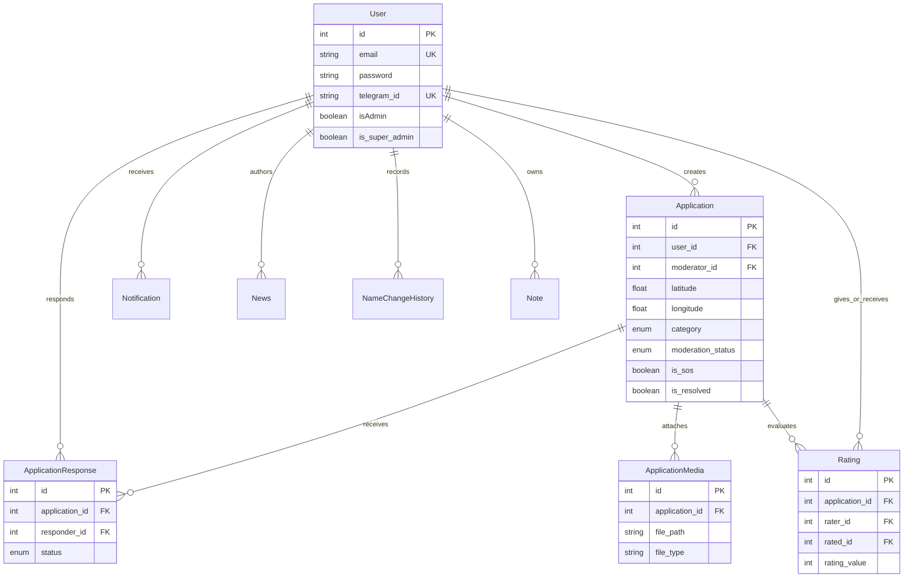

# Database model

The revised mutual-aid additions and the conceptual-to-physical mapping are documented in [the October implementation](mutual-aid-implementation.md). The diagram below records the retained pre-update core.

Reconstructed from `backend/website/models.py`. Production and integration
tests use PostgreSQL. The test suite requires a disposable database.

Revision `20261119_profile_feedback` adds `user.capability_onboarding_seen`
and `rating.is_hidden`. Existing users are treated as having seen onboarding.
Revision `20261119_application_uuid` backfills unique UUIDv4 values into
`application.public_id` and makes that column required. The integer key and its
foreign keys are used internally. New links prefer the UUID; legacy numeric
request links still resolve with the same authorization checks.

Categories: `food`, `medicine`, `shelter`, `emergency`. Moderation: `pending`, `approved`, `rejected`. Responses: `pending`, `accepted`, `completed`, `cancelled`. UI labels must not substitute for persisted enum values.

The existing application bootstrap creates tables before running Alembic. The initial migration adjusts foreign keys rather than creating the entire schema. The news migration therefore checks for an already bootstrapped table. This compatibility behavior is retained; the project has not been redesigned into a migrations-only startup workflow.

